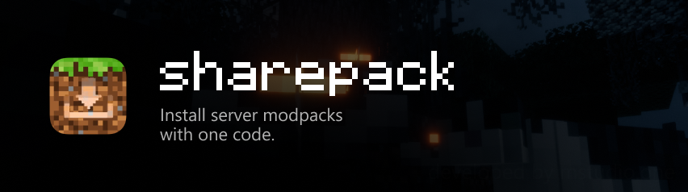
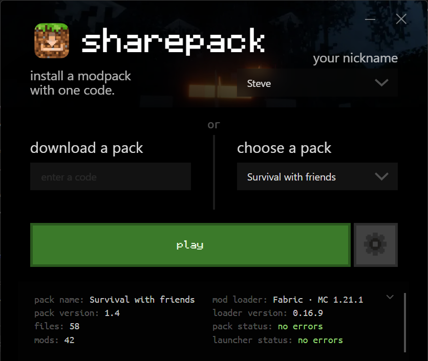
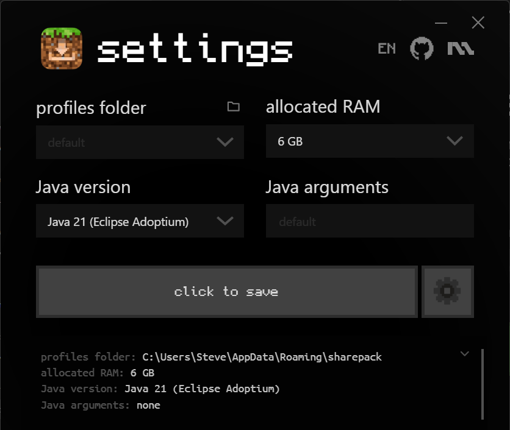

**English** | [Русский](README.ru.md)

# sharepack

A Minecraft launcher that installs a server's modpack from a single code.

The server owner installs `sharepack-server.jar`, puts the client mods into a folder and gets a code. Players enter a nickname and the code in `sharepack.exe`. The launcher downloads the game, Java, the mod loader and the mods directly from the owner's server. No central server is involved.

Downloads: [latest release](https://github.com/mapsovich/sharepack/releases/latest).

## Screenshots

 

## Server owners

1. Install `sharepack-server.jar`:
   - Fabric, Quilt, Forge, NeoForge: put it into `mods/`;
   - Paper, Spigot: put it into `plugins/`;
   - any other server: run `java -jar sharepack-server.jar` in the server folder.
2. Start the server. A `sharepack/` folder is created next to it:
   ```
   sharepack/
     pack.json          pack name, game version, mod loader
     files/             files that players always get in their current version
       mods/
       config/
     defaults/          files that players get only once (e.g. options.txt)
     config.properties  language, port, address, key
     CODE.txt           the code for players
   ```
3. Put the client mods into `files/mods/` and, if needed, configs into `files/config/`.
4. Open the pack port (TCP 25566 by default):
   - home server: on most routers the server part does this itself through UPnP and says so in the console. If it can't, forward the port on your router by hand;
   - game server hosting: add a second port in the hosting control panel and set it as `http-port` in `sharepack/config.properties`.
5. Give players the code from the server console or from `sharepack/CODE.txt`.

Files can be changed while the server is running: the launcher compares them on every start.

### files/ and defaults/

- `files/` is synced on every launch. If a file differs from the server copy, it is downloaded again.
- `defaults/` is copied only if the player doesn't have the file yet. After that the player's copy is never replaced. Use it for settings players are likely to change, such as `options.txt` or keybindings.

### pack.json

```json
{
  "name": "My server",
  "version": "1.0",
  "minecraft": "auto",
  "loader": "auto",
  "loader_version": "auto",
  "memory": 4096,
  "managed_dirs": ["mods"]
}
```

- `minecraft`, `loader`, `loader_version`: `auto` means the values of the running server. To set them by hand: `minecraft` is a version such as `1.20.1`, `loader` is one of `vanilla`, `fabric`, `forge`, `neoforge`, `quilt`, and an empty `loader_version` means the latest loader version.
- `version`: pack version shown in the launcher. Increase it when the pack changes.
- `memory`: RAM for the game in MB. Players can override it in the settings.
- `managed_dirs`: folders that are kept identical to the pack. Any file in these folders that is not in the pack is deleted on the player's side. For example, a mod removed from `files/mods/` is also removed from players. Files outside these folders are never deleted.
- `server` (optional): `"address:port"` added to the in-game server list. By default the server address and the port from `server.properties` are used.

### Client-side mods

`files/mods/` holds the mods for players: usually the server mods plus client-only mods (minimaps, shaders), without server-only ones. If the game reports "mismatched mod channel list" when joining, the listed mods are required on the server too. JEI is a common case because it bundles MezzConfig.

### config.properties

- `language`: console language, `auto`, `ru` or `en`.
- `http-port`: pack port, 25566 by default.
- `public-address`: public IP or domain. If empty, the address is detected in this order: the hosting panel IP (`SERVER_IP` on Pterodactyl/Pelican), `server-ip` from `server.properties`, then api.ipify.org. The detected address is printed in the console. With a dynamic home IP, use a domain (for example from DuckDNS) so the code doesn't change.
- `upnp`: `auto` forwards the pack port on a home router through UPnP and removes the forward when the server stops; `off` disables it. It isn't used on hostings and on machines with a public IP. On start it also checks the router's internet address and warns about a shared ISP address (CGNAT) or a VPN, when players can't connect even with the port forwarded.
- `key`: secret key, part of the code. Delete the line to generate a new key; the old code stops working. Codes made before v2026.b2 are replaced automatically on the first start.

### Without a game server (single-player world)

You can play in your own single-player world opened to LAN, with no game server and no hosting:

1. Put `sharepack-server.jar` into any folder and run `java -jar sharepack-server.jar` there.
2. Without a game server the version can't be detected, so set `minecraft`, `loader` and, if needed, `loader_version` in `sharepack/pack.json` instead of `auto`.
3. Put [LAN World Plug-n-Play](https://modrinth.com/mod/mcwifipnp) into `files/mods/`, and on Fabric or Quilt also [Fabric API](https://modrinth.com/mod/fabric-api). Without it, a world opened to LAN asks every player for a Microsoft account and nickname-only players can't join.
4. The pack port (TCP 25566) is forwarded on your router automatically through UPnP; if the console says it didn't work, forward it by hand.
5. Start the game from the launcher, open your world, press Esc → "Open to LAN", turn **Online Mode** off and open the world. The mod tries to forward the world port through UPnP and prints the addresses in the chat. If your router doesn't support UPnP, forward that port by hand; set a fixed port in the same screen so it doesn't change.
6. Friends join with "Multiplayer" → "Direct Connection" and your address with the world port. To get the right server in their list, set `server` in `pack.json` to `"address:port"`.

Friends can play only while your game and `sharepack-server.jar` are running. Tested with Fabric 1.21.1.

## Players

Run `sharepack.exe`, enter a nickname and the code, press "play". The exe can be kept anywhere; settings and game files are stored in `%APPDATA%\sharepack`.

- Saved nicknames open with the arrow in the nickname field.
- Packs that were played before are listed under "choose a pack", so the code is needed only once. Each pack has buttons to open its folder, redownload it (worlds, screenshots and `options.txt` are kept) and delete it (two clicks).
- The settings (gear icon) contain the profiles folder, RAM (`4096` or `4G`), a custom `java.exe` and Java arguments.
- The language follows Windows and can be switched with the `RU`/`EN` button in the settings.
- The light or dark theme also follows Windows; the button next to `RU`/`EN` switches between same as Windows, light and dark.
- Requires Microsoft Edge WebView2, which is included in Windows 10 and 11.

## Updates

The launcher checks GitHub releases on startup. If a newer version exists, it offers to download it, replaces the exe and restarts. The server plugin checks on startup as well and prints a message in the console.

The launcher and the server part have separate version numbers (`client/VERSION` and `server/VERSION`). A release that changes only one of them offers an update only for that part: players aren't asked to update the launcher because of a server fix, and server owners aren't told about launcher changes.

## Security

- The code holds the server address, the pack port and a 96-bit secret. Codes of different servers can't match: the address and port are part of the code.
- The secret is never sent over the network. The launcher requests files with an access key derived from it, and the server signs the file list (HMAC-SHA256) with another derived key. Every downloaded file is checked against the SHA-256 in the signed list. A file list or a mod modified on the way (for example on public Wi-Fi) is rejected.
- Paths from the server are accepted only inside the pack folder. `managed_dirs` can't point at worlds, screenshots, `options.txt` or the game files.
- The pack server accepts at most 32 connections at once, limits request size and time, and blocks an IP for 10 minutes after 20 requests with a wrong key.
- Mods are programs. Install packs only from servers you trust.

## Notes

- Players log in by nickname without a Microsoft account, so the server needs `online-mode=false`. Install an authentication mod (for example EasyAuth), otherwise anyone can join under another player's nickname.
- Hostings that provide only one port (such as Aternos) are not supported: the pack needs a second port.
- When the game crashes, the launcher shows the log path: `%APPDATA%\sharepack\profiles\<key>\launcher_log.txt`.

## Building

- Launcher: `build_exe.bat` (Python 3, creates `.venv` on the first run) → `dist\sharepack.exe`.
- Server: `server\build.bat` (JDK 8+) → `server\sharepack-server.jar`.

```
client/launcher.py   launcher logic (install, launch)
client/i18n.py       launcher messages in Russian and English
client/ui/           launcher UI (HTML/CSS/JS)
server/              mod/plugin for the server
```

## License

GPL-3.0, see [LICENSE](LICENSE).

Fonts: [Monocraft](https://github.com/IdreesInc/Monocraft) (SIL Open Font License 1.1) and Ubuntu Mono (Ubuntu Font Licence 1.0), license texts in [client/ui/assets/LICENSES](client/ui/assets/LICENSES).

Not affiliated with Mojang or Microsoft. Minecraft is a trademark of Mojang AB.
