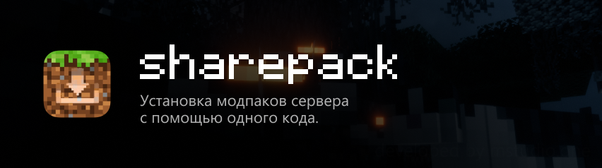
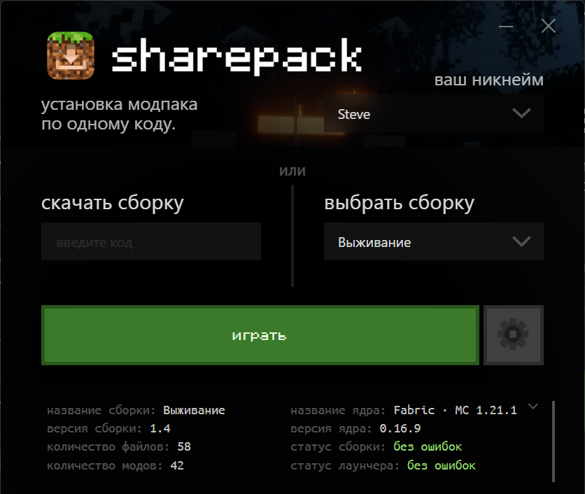
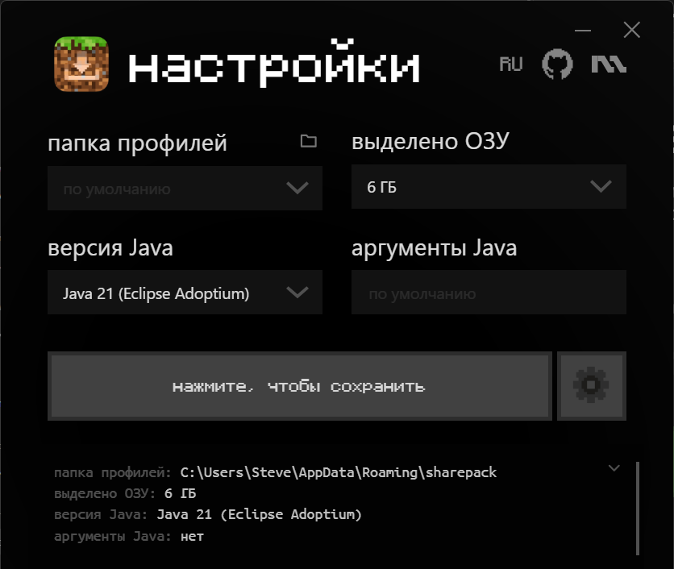

[English](README.md) | **Русский**

# sharepack

Лаунчер Minecraft, который устанавливает сборку сервера по одному коду.

Владелец сервера устанавливает `sharepack-server.jar`, кладёт клиентские моды в папку и получает код. Игроки вводят в `sharepack.exe` никнейм и код. Лаунчер скачивает игру, Java, загрузчик модов и моды напрямую с сервера владельца. Центрального сервера нет.

Загрузка: [последний релиз](https://github.com/mapsovich/sharepack/releases/latest).

## Скриншоты

 

## Владельцу сервера

1. Установите `sharepack-server.jar`:
   - Fabric, Quilt, Forge, NeoForge: в папку `mods/`;
   - Paper, Spigot: в папку `plugins/`;
   - другой сервер: запустите `java -jar sharepack-server.jar` в папке сервера.
2. Запустите сервер. Рядом с ним появится папка `sharepack/`:
   ```
   sharepack/
     pack.json          название сборки, версия игры, загрузчик модов
     files/             файлы, которые у игроков всегда совпадают с сервером
       mods/
       config/
     defaults/          файлы, которые игроки получают только один раз (например, options.txt)
     config.properties  язык, порт, адрес, ключ
     CODE.txt           код для игроков
   ```
3. Положите клиентские моды в `files/mods/` и, если нужно, конфиги в `files/config/`.
4. Откройте порт раздачи (по умолчанию TCP 25566):
   - домашний сервер: откройте (пробросьте) порт на роутере;
   - хостинг игровых серверов: добавьте второй порт в панели управления сервером и укажите его в `http-port` в `sharepack/config.properties`.
5. Передайте игрокам код из консоли сервера или из `sharepack/CODE.txt`.

Файлы можно менять во время работы сервера: лаунчер сверяет их при каждом запуске.

### files/ и defaults/

- `files/` синхронизируется при каждом запуске. Если файл у игрока отличается от серверного, он скачивается заново.
- `defaults/` копируется, только если у игрока ещё нет такого файла. После этого файл игрока больше не заменяется. Подходит для настроек, которые игроки обычно меняют под себя: `options.txt`, раскладка клавиш.

### pack.json

```json
{
  "name": "Мой сервер",
  "version": "1.0",
  "minecraft": "auto",
  "loader": "auto",
  "loader_version": "auto",
  "memory": 4096,
  "managed_dirs": ["mods"]
}
```

- `minecraft`, `loader`, `loader_version`: `auto` означает значения запущенного сервера. Чтобы задать вручную: `minecraft` содержит версию, например `1.20.1`; `loader` принимает `vanilla`, `fabric`, `forge`, `neoforge` или `quilt`; пустой `loader_version` означает последнюю версию загрузчика.
- `version`: версия сборки, отображается в лаунчере. Увеличивайте её при изменениях.
- `memory`: ОЗУ для игры в МБ. Игрок может изменить значение в настройках.
- `managed_dirs`: папки, содержимое которых у игрока приводится в точное соответствие со сборкой. Файлы в этих папках, которых нет в сборке, у игрока удаляются. Например, мод, удалённый из `files/mods/`, удалится и у игроков. Файлы вне этих папок не удаляются никогда.
- `server` (необязательно): `"адрес:порт"` для списка серверов в игре. По умолчанию используются адрес сервера и порт из `server.properties`.

### Клиентские моды

В `files/mods/` кладутся моды для игроков: как правило, моды сервера и клиентские моды (миникарты, шейдеры), без серверных. Если при входе игра сообщает «mismatched mod channel list», перечисленные моды нужны и на сервере. Так часто бывает с JEI, в который встроен MezzConfig.

### config.properties

- `language`: язык консоли, `auto`, `ru` или `en`.
- `http-port`: порт раздачи, по умолчанию 25566.
- `public-address`: внешний IP или домен. Если пусто, адрес определяется в таком порядке: IP из панели хостинга (`SERVER_IP` в Pterodactyl/Pelican), `server-ip` из `server.properties`, затем api.ipify.org. Найденный адрес выводится в консоль. Если домашний IP меняется, используйте домен (например, от DuckDNS), чтобы код оставался прежним.
- `key`: секретный ключ, входит в код. Если удалить строку, будет создан новый ключ, а старый код перестанет работать. Коды, созданные до v2026.b2, заменяются автоматически при первом запуске.

## Игрокам

Запустите `sharepack.exe`, введите никнейм и код, нажмите «играть». Exe можно хранить в любой папке; настройки и файлы игры находятся в `%APPDATA%\sharepack`.

- Сохранённые никнеймы открываются стрелкой в поле никнейма.
- Сборки, которые уже запускались, есть в списке «выбрать сборку», поэтому код нужен только один раз. У каждой сборки есть кнопки: открыть папку, перекачать (миры, скриншоты и `options.txt` сохранятся) и удалить (двойное нажатие).
- В настройках (шестерёнка): папка профилей, ОЗУ (`4096` или `4G`), своя `java.exe` и аргументы Java.
- Язык выбирается по языку Windows, переключается кнопкой `RU`/`EN` в настройках.
- Светлая или тёмная тема тоже берётся из Windows. Кнопка рядом с `RU`/`EN` переключает: как в Windows, светлая, тёмная.
- Нужен Microsoft Edge WebView2, в Windows 10 и 11 он уже установлен.

## Обновления

При запуске лаунчер проверяет релизы на GitHub. Если есть новая версия, он предлагает её скачать, заменяет exe и перезапускается. Серверная часть тоже проверяет обновления при запуске и сообщает о них в консоли.

У лаунчера и серверной части свои номера версий (`client/VERSION` и `server/VERSION`). Если релиз меняет только одну из частей, обновление предлагается только для неё: игрокам не придётся обновлять лаунчер из-за исправления в сервере, а владельцам серверов не будут приходить сообщения об изменениях лаунчера.

## Безопасность

- Код содержит адрес сервера, порт раздачи и 96-битный секрет. Коды разных серверов совпасть не могут: адрес и порт входят в код.
- Секрет не передаётся по сети. Лаунчер запрашивает файлы по ключу доступа, полученному из секрета, а сервер подписывает список файлов (HMAC-SHA256) другим производным ключом. Каждый скачанный файл сверяется с SHA-256 из подписанного списка. Список файлов или мод, изменённые по пути (например, в общественной сети Wi-Fi), отклоняются.
- Пути от сервера принимаются только внутри папки сборки. `managed_dirs` не может указывать на миры, скриншоты, `options.txt` и файлы игры.
- Сервер раздачи обслуживает не больше 32 соединений одновременно, ограничивает размер и время запроса и блокирует IP на 10 минут после 20 запросов с неверным ключом.
- Моды являются программами. Устанавливайте сборки только с серверов, которым доверяете.

## Важно

- Игроки входят по никнейму без аккаунта Microsoft, поэтому на сервере нужен `online-mode=false`. Установите мод авторизации (например, EasyAuth), иначе любой сможет зайти под чужим никнеймом.
- Хостинги с одним портом (например, Aternos) не поддерживаются: для раздачи нужен второй порт.
- Если игра вылетела, лаунчер покажет путь к логу: `%APPDATA%\sharepack\profiles\<ключ>\launcher_log.txt`.

## Сборка

- Лаунчер: `build_exe.bat` (Python 3, при первом запуске создаёт `.venv`) → `dist\sharepack.exe`.
- Сервер: `server\build.bat` (JDK 8+) → `server\sharepack-server.jar`.

```
client/launcher.py   логика лаунчера (установка, запуск)
client/i18n.py       сообщения лаунчера на русском и английском
client/ui/           интерфейс лаунчера (HTML/CSS/JS)
server/              мод/плагин для сервера
```

## Лицензия

GPL-3.0, см. [LICENSE](LICENSE).

Шрифты: [Monocraft](https://github.com/IdreesInc/Monocraft) (SIL Open Font License 1.1) и Ubuntu Mono (Ubuntu Font Licence 1.0), тексты лицензий в [client/ui/assets/LICENSES](client/ui/assets/LICENSES).

Проект не связан с Mojang и Microsoft. Minecraft является товарным знаком Mojang AB.
